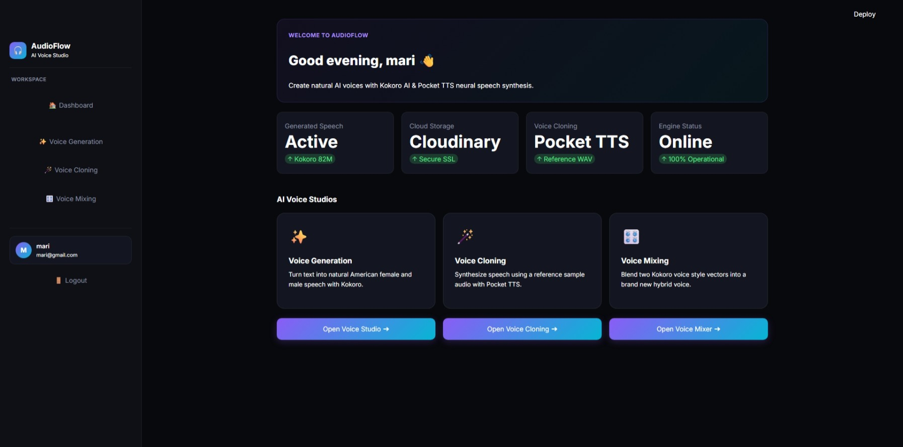
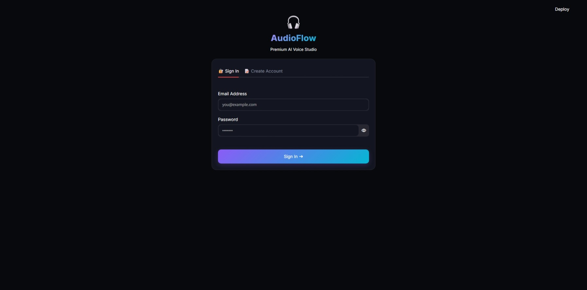
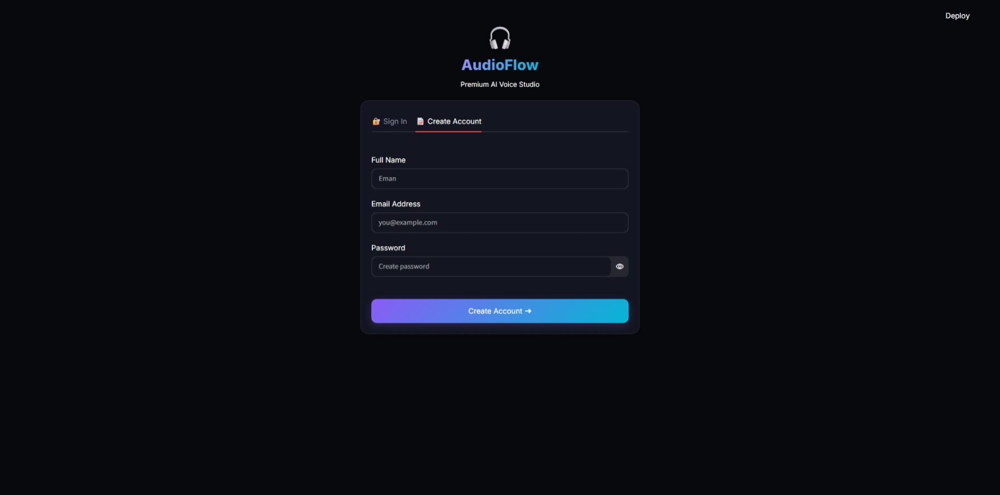
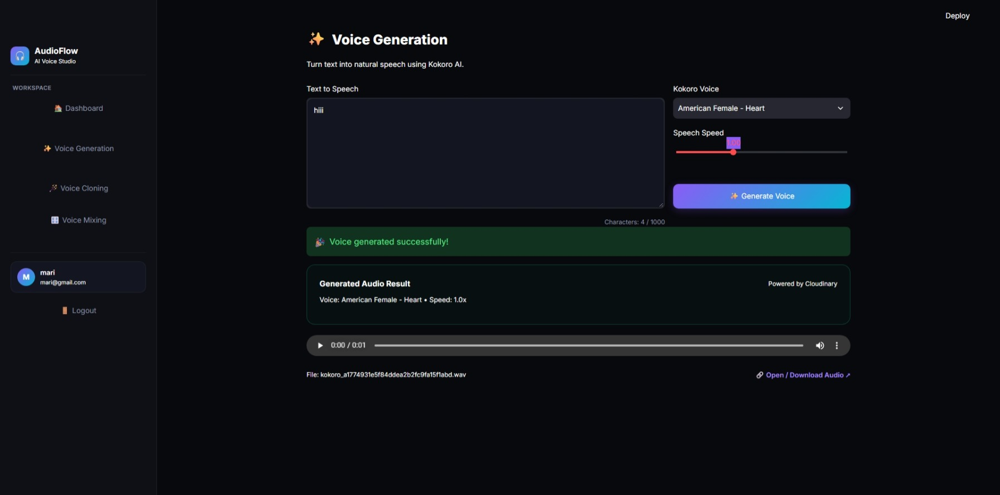
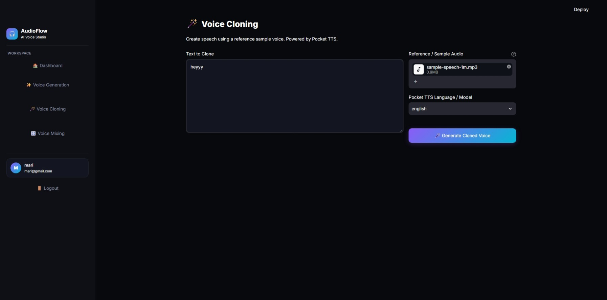
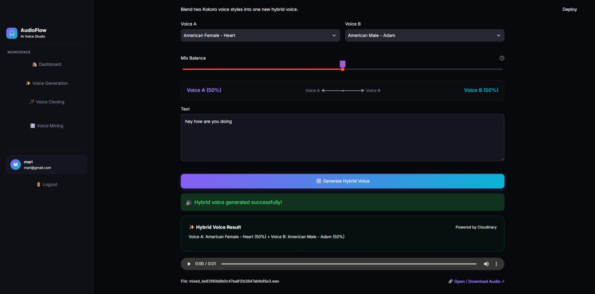

# AudioFlow — AI Voice Studio

**AudioFlow** is a full-stack AI-powered voice studio for generating speech, cloning voices from reference audio, and creating blended voices using neural voice-vector interpolation.

Built with **FastAPI, Streamlit, Kokoro TTS, PocketTTS, MongoDB, and Cloudinary**.

## Features

- **AI Voice Generation:** Convert text into speech using Kokoro TTS and available voice presets.
- **Voice Cloning:** Generate speech using a user-provided reference voice sample through PocketTTS.
- **Neural Voice Mixing:** Blend supported Kokoro voice representations to create customized voice combinations.
- **User Authentication:** Registration and login using JWT-based authentication.
- **Audio Management:** Store generated audio in Cloudinary and associated metadata in MongoDB.
- **Interactive Interface:** Streamlit-based interface for voice workflows.

## Screenshots

### Dashboard


### Authentication

**Sign In**



**Register**



### AI Voice Generation


### Voice Cloning


### Neural Voice Mixing


## Tech Stack

| Layer | Technologies |
|---|---|
| Frontend | Python, Streamlit |
| Backend | Python, FastAPI, Uvicorn |
| Text-to-Speech | Kokoro TTS |
| Voice Cloning | PocketTTS |
| Voice Mixing | Neural voice-vector interpolation |
| Database | MongoDB |
| Audio Storage | Cloudinary |
| Authentication | JWT |

## Project Structure

```text
AudioFlow/
├── backend/
│   ├── main.py
│   ├── voice_cloning.py
│   ├── voice_mixing.py
│   └── requirements.txt
├── frontend/
│   ├── app.py
│   └── requirements.txt
├── docs/
│   └── screenshots/
└── README.md
```

## Local Setup

### 1. Clone the repository

```bash
git clone https://github.com/EmanZahid1644/AudioFlow.git
cd AudioFlow
```

### 2. Set up the backend

Create and activate a Python 3.12 virtual environment:

```bash
cd backend
py -3.12 -m venv venv312
venv312\Scripts\activate
pip install -r requirements.txt
```

Configure the required MongoDB, Cloudinary, and authentication environment variables in `backend/.env`. Never commit credentials to Git.

Start the API:

```bash
python -m uvicorn main:app --host 127.0.0.1 --port 8001
```

API documentation: `http://127.0.0.1:8001/docs`

### 3. Set up the frontend

Open another terminal from the project root:

```bash
cd frontend
pip install -r requirements.txt
streamlit run app.py
```

Configure the frontend backend URL to point to `http://127.0.0.1:8001` for local development.

Frontend: `http://localhost:8501`

> Model dependencies, external services, and environment configuration are required for full functionality.

## API Overview

| Method | Endpoint | Description |
|---|---|---|
| POST | `/register` | Register a user |
| POST | `/login` | Authenticate a user |
| GET | `/kokoro-voices` | List available Kokoro voices |
| POST | `/generate-voice` | Generate speech from text |
| POST | `/clone-voice` | Generate cloned speech from reference audio |
| POST | `/voice/mix` | Mix supported voice representations |
| POST | `/mix-voices` | Alternative voice-mixing endpoint |

Interactive request schemas are available through FastAPI Swagger UI at `/docs`.

## Responsible Use

Voice cloning should only be performed with the speaker's knowledge and consent. Generated audio should not be used for impersonation, deception, or unauthorized identity replication.

## Development Status

AudioFlow is a portfolio project demonstrating the integration of speech-generation models, voice processing, API development, cloud storage, authentication, and an interactive Python frontend.

## Author

**Eman Zahid**

[GitHub](https://github.com/EmanZahid1644)
