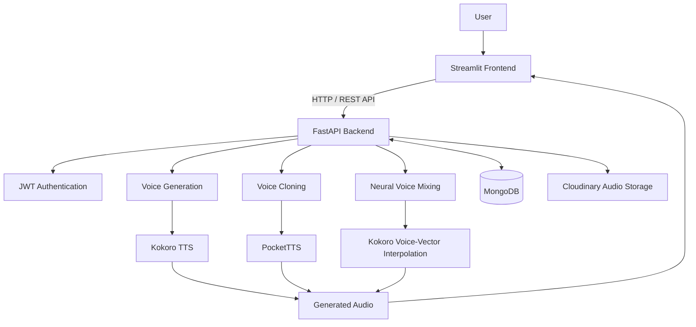

# AudioFlow — AI Voice Studio

### AI-Powered Speech Generation, Voice Cloning & Neural Voice Mixing

AudioFlow is a full-stack AI-powered voice studio designed to transform text into natural-sounding speech, generate speech using reference voice samples, and create customized voices through neural voice-vector interpolation.

The platform combines **Kokoro TTS**, **PocketTTS**, **FastAPI**, and **Streamlit** to deliver an interactive environment for experimenting with modern speech AI.

**Core Capabilities:** Text-to-Speech | Voice Cloning | Neural Voice Mixing | Authentication | Cloud Audio Storage

---

## Overview

AudioFlow brings multiple speech AI workflows into a single application.

Users can generate speech using predefined AI voices, provide reference audio for voice cloning, and experiment with blending supported voice representations.

The application uses a Python-based frontend and backend, with MongoDB for data management and Cloudinary for audio storage.

## Key Features

### 1. AI Voice Generation

Generate natural-sounding speech from text using the Kokoro TTS engine.

- Text-to-speech generation
- Selection from available Kokoro voices
- Audio playback and generation workflow
- FastAPI-powered inference endpoints

### 2. AI Voice Cloning

Generate speech conditioned on a user-provided reference voice sample using PocketTTS.

- Upload reference audio
- Provide custom text for synthesis
- Generate and retrieve speech output
- Integrate with cloud audio storage

**Note:** Voice cloning availability and output quality depend on model initialization, reference audio quality, and runtime configuration. The backend may use a predefined voice fallback when cloning is unavailable.

### 3. Neural Voice Mixing

Create blended voices using interpolation between supported Kokoro voice representations.

- Select voices for mixing
- Adjust mixing parameters
- Generate speech from interpolated voice representations
- Experiment with different voice combinations

### 4. User Authentication

- User registration
- Login functionality
- JWT-based authentication
- Backend authentication endpoints

### 5. Audio Storage and Metadata

- Cloudinary integration for audio storage
- MongoDB integration for associated data
- Backend-managed audio workflows

---

## Application Screenshots

### Dashboard

The main interface for accessing AudioFlow's AI voice capabilities.


### Sign In


### Registration


### AI Voice Generation

Generate speech using Kokoro TTS and available voice presets.


### AI Voice Cloning

Upload a reference audio sample and generate speech using the voice cloning workflow.


### Neural Voice Mixing

Blend supported AI voice representations to create customized speech output.


---

## System Architecture

AudioFlow follows a frontend-backend architecture. The Streamlit application communicates with the FastAPI backend through HTTP requests. The backend coordinates authentication, speech models, audio processing, and external storage services.



### Architecture Components

| Component | Responsibility |
|---|---|
| Streamlit | Interactive user interface |
| FastAPI | API endpoints, request handling, and model integration |
| Kokoro TTS | Text-to-speech synthesis |
| PocketTTS | Reference-based voice cloning |
| Voice Mixing Engine | Neural voice-vector interpolation |
| MongoDB | Application data and audio metadata |
| Cloudinary | Cloud audio storage |
| JWT | Authentication token handling |

---

## Technology Stack

| Category | Technologies |
|---|---|
| Programming Language | Python |
| Frontend | Streamlit |
| Backend | FastAPI, Uvicorn |
| Speech Generation | Kokoro TTS |
| Voice Cloning | PocketTTS |
| Voice Mixing | Kokoro Voice Vectors |
| Machine Learning Runtime | PyTorch |
| Database | MongoDB |
| Cloud Storage | Cloudinary |
| Authentication | JWT |
| API Documentation | Swagger UI / OpenAPI |
| Version Control | Git, GitHub |

---

## Project Structure

```text
AudioFlow/
|
|-- backend/
|   |-- main.py
|   |-- voice_cloning.py
|   |-- voice_mixing.py
|   |-- requirements.txt
|   |-- .env                 # Local configuration (not committed)
|
|-- frontend/
|   |-- app.py
|   |-- requirements.txt
|
|-- docs/
|   |-- screenshots/
|       |-- dashboard.png
|       |-- login.png
|       |-- register.png
|       |-- voice-generation.png
|       |-- voice-cloning.png
|       |-- voice-mixing.png
|
|-- .gitignore
|-- README.md
```

*The structure above highlights the main application files; additional supporting files may be present.*

---

## Getting Started

### Prerequisites

- Python 3.12
- Git
- MongoDB connection
- Cloudinary account and credentials
- Internet access for any required model downloads
- Sufficient local resources to initialize the speech models

### 1. Clone the Repository

```bash
git clone https://github.com/EmanZahid1644/AudioFlow.git
cd AudioFlow
```

### 2. Configure the Backend

Open a terminal in the backend directory:

```cmd
cd backend
```

Create a Python virtual environment:

```cmd
py -3.12 -m venv venv312
```

Activate it:

```cmd
venv312\Scripts\activate
```

Install backend dependencies:

```cmd
pip install -r requirements.txt
```

Configure `backend/.env` with the environment variables expected by the backend, including the required database, cloud storage, and authentication settings.

Do not commit `.env` files, API keys, credentials, or private audio samples.

### 3. Run the FastAPI Backend

From the `backend` directory:

```cmd
venv312\Scripts\python.exe -m uvicorn main:app --host 127.0.0.1 --port 8001
```

Backend URL:

`http://127.0.0.1:8001`

Interactive API documentation:

`http://127.0.0.1:8001/docs`

### 4. Configure the Frontend

Open a second terminal and navigate to the frontend directory:

```cmd
cd frontend
```

Create and activate a virtual environment if needed, then install dependencies:

```cmd
py -3.12 -m venv venv
venv\Scripts\activate
pip install -r requirements.txt
```

Configure the frontend to communicate with the local backend at:

`http://127.0.0.1:8001`

### 5. Launch the Streamlit Application

```cmd
streamlit run app.py
```

Open:

`http://localhost:8501`

**Important:** Keep the FastAPI backend running in a separate terminal while using the Streamlit application.

---

## REST API Endpoints

AudioFlow exposes the following FastAPI endpoints.

| Method | Endpoint | Purpose |
|---|---|---|
| POST | `/register` | Create a user account |
| POST | `/login` | Authenticate an existing user |
| GET | `/kokoro-voices` | Retrieve available Kokoro voice options |
| POST | `/generate-voice` | Generate speech from text |
| POST | `/clone-voice` | Generate speech from reference voice audio |
| POST | `/voice/mix` | Generate speech using mixed voice representations |
| POST | `/mix-voices` | Alternative voice-mixing endpoint |

### API Documentation

FastAPI automatically exposes interactive Swagger documentation at:

`http://127.0.0.1:8001/docs`

Refer to Swagger UI for the exact request bodies, parameters, authentication requirements, and response formats.

### Deprecated Endpoints

The backend also contains legacy endpoints that return HTTP 410 Gone:

- `POST /receive`
- `POST /clone-generate`
- `GET /audios`

These are retained for compatibility signaling and are not part of the active voice workflows.

---

## AI Processing Workflows

### Text-to-Speech

```text
User Text
   |
   v
Voice Selection
   |
   v
FastAPI Request
   |
   v
Kokoro TTS Inference
   |
   v
Generated Speech
   |
   v
Audio Playback
```

### Voice Cloning

```text
Reference Audio + Input Text
             |
             v
       Streamlit UI
             |
             v
       FastAPI Backend
             |
             v
       PocketTTS Engine
             |
             v
      Generated Speech
             |
             v
      Audio Output
```

*Actual cloning depends on runtime support; the backend includes a fallback path when cloning is unavailable.*

### Neural Voice Mixing

```text
Voice A + Voice B
        |
        v
 Mixing Parameters
        |
        v
 Voice-Vector Interpolation
        |
        v
 Kokoro Speech Synthesis
        |
        v
 Blended Speech Output
```

---

## Engineering Highlights

This project demonstrates practical experience with:

- Integrating speech AI models into a Python backend
- Building REST APIs using FastAPI
- Developing interactive AI applications with Streamlit
- Implementing authentication workflows
- Managing audio files and cloud storage
- Working with MongoDB
- Building neural voice interpolation workflows
- Handling model initialization and runtime limitations
- Structuring a full-stack AI application

---

## Responsible AI and Voice Safety

AudioFlow is intended for educational, experimental, and authorized creative use.

Voice cloning should only be performed using audio that the user owns or has explicit permission to use. The system should not be used to impersonate individuals, deceive others, or generate unauthorized voice replicas.

---

## Project Status

**Portfolio Project — Active Development**

The application includes implemented interfaces and backend endpoints for AI voice generation, reference-based voice cloning, and neural voice mixing.

Runtime behavior depends on installed model dependencies, service credentials, and the availability of the required inference resources.

---

## Author

**Eman Zahid**

AI Engineer | Python Developer | Applied AI Enthusiast

GitHub: [EmanZahid1644](https://github.com/EmanZahid1644)

---

*AudioFlow — Exploring the possibilities of AI-powered speech generation and voice customization.*
